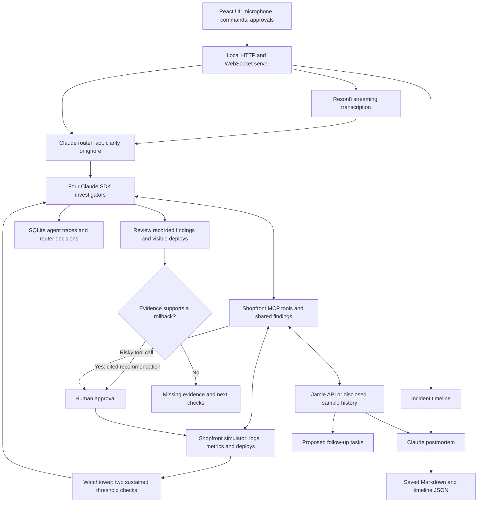

# Control Tower

**An incident commander you talk to.** Control Tower watches production, notices when it breaks, declares the incident itself and puts four Claude investigators on it. Then it keeps you briefed out loud. You steer it hands-free and approve risky actions by voice. When it's over, it writes the postmortem.

Most agent tools wait for a prompt. During an outage, you're the bottleneck: the tower acts first and lets you approve.

**Prototype scope:** production metrics, logs, deploys, rollbacks, restarts and status-page posts run against a deterministic Shopfront simulator. Claude investigation and recommendation calls are real when configured; voice input uses Reson8. Jamie uses its real API when a key is configured and clearly documented sample incident notes otherwise. There is no live production connector yet.

## 2-minute submission demo

Start with `npm run dev` and open http://localhost:5173. Hold **Space** to talk, or type in the command bar. The recording storyboard and narration are in [demo/submission-script.md](demo/submission-script.md).

1. **Detect:** choose **Simulate a bad deploy**. The tower declares the incident after two 5-second checks at or above 5% errors. The simulator ramps up, so allow roughly 15–20 seconds from injection; rehearse the actual timing.
2. **Investigate:** show one recorded finding and the matching deploy diff. Ask “Logs, what are you seeing?” while the investigators continue working.
3. **Decide:** show the evidence behind a rollback request. If the investigators finish without applying a fix, a separate review reads their findings and deploy records, then either proposes a cited rollback or explains what evidence is missing. The review never reads the simulator's known culprit.
4. **Approve:** approve the specific rollback request by voice or button. Show the error rate falling; the simulated recovery takes about 45 seconds.
5. **Explain:** resolve the incident when healthy. Show the generated postmortem and a tool trace in **Activity**.

Capture a full successful run first, then cut it to two minutes. Label shortened waits; never imply that generation or recovery was instantaneous. Every voice action has a typed or button equivalent. Do not promise that a particular ambiguous sentence will always split the votes.

## How the tower decides

You talk, Reson8 transcribes each turn, and a decision engine uses vote agreement to work out which agent you meant and what you want:

```
mic → Reson8 (turns STT) → router: N parallel Haiku votes → act / ask / ignore → agent inbox
```

- **Vote agreement, not probability of correctness.** Five parallel samples come from the same model and can share the same mistakes. By default, at least 3 of 5 must agree on target, intent and incident action to apply a command; ignoring chatter requires 4 of 5. Missing responses still count in the denominator. Unclear targets and invalid incident actions ask for clarification even if votes agree. A clarification can name the competing targets, and the next sentence is treated as the answer. The API field remains named `confidence` for compatibility; its value is the share of requested votes agreeing.
- **Intents:**
  - `assign`: starts a new task, including when addressed to an existing agent. Follow-ups and corrections stay with the current task.
  - `stop`: interrupt.
  - `correct`: injected into the running turn.
  - `approve`: wrap up and commit.
  - `rule`: a standing rule for every agent, persisted in `data/rules.json`.
  - `incident`: declare, update or stand down the incident.
  - `report`: "logs, what are you seeing?" The tower answers out loud from the agents' recent activity, without interrupting them.
  - `chatter`: ignored.
- **Task view:** navigate by task, with its agents grouped beneath it. Open an agent for its history, outputs and direct messages. Commands within a selected task address that task’s agents; standing rules remain global.
- **Restarts:** task-owned agents and results are saved atomically to `data/session.json`. Tasks with saved successful results recover as ready for review. Interrupted tasks are marked failed and their agents paused; orchestration does not automatically resume. Legacy agents without a valid task are not restored.

## Proactive: the watchtower

The tower watches production without being asked. Every 5 seconds it checks the store's checkout error rate (the simulated Shopfront, healthy by default). When errors stay above 5% for two checks in a row, it acts on its own:

1. **Detect and declare:** it opens an incident, starts the four investigators, and tells you out loud what it saw and the most likely suspect: "Heads up: checkout errors jumped to 7 percent at 16:12, 12 seconds after deploy 482 to payments-api by sam. I've started four investigators. Say 'stand down' to cancel." The incident opens on screen by itself, and your other tasks keep running.
2. **Investigate and propose:** investigators gather evidence. If they finish without fixing it, one structured model review reads their recorded findings and visible deploy records. It can recommend a rollback with numbered finding citations, or ask for concrete next checks. The server validates citations and the deploy ID; human approval is still required. Initial deploy suspicion is timing correlation, not a diagnosis.
3. **Brief:** a spoken update at most every 45 seconds, and only when something has changed (the error trend, new findings, actions, approvals waiting). When errors stay back at normal, it offers to resolve; when you close the incident, it gives a closing summary.
4. **Follow up:** when Jamie's `meeting.completed` webhook delivers the review call's action items, the tower proposes them as tasks ("Want agents on them? Say 'start the follow-ups'").

The top bar shows what it's watching ("watching · checkout 0.4%" with a sparkline). The ⋯ menu turns it on or off and has **Simulate a bad deploy (demo)**. "Stand down" calls off a false alarm; the watchtower re-arms once the store is healthy again.

## Incident response

Say "declare an incident: checkout is failing" (or click **Declare incident**). Four investigators start on a simulated Shopfront outage:

- **Logs** finds the error signature and where the failures start.
- **Changes** matches recent deploys and config changes against when the impact began.
- **Metrics** measures the blast radius and rules red herrings in or out.
- **Comms** keeps the public status page up to date.

They reach production only through tools (`server/incident/`): logs, metrics, deploys and diffs, plus a shared findings log so they build on each other's work. They also have a search over past incident calls recorded with [Jamie](https://www.meetjamie.ai).

- **Spoken approvals:** a rollback, a restart or a status-page post pauses the agent. The tower asks out loud ("Changes, agent 2, wants to roll back deploy #482. Approve?"). Say "approve" or "no", or use the buttons.
- **Evidence review:** when all investigators are idle, stopped or failed and the outage remains, the tower reviews the available findings once per evidence snapshot. A rollback needs a valid, not-yet-rolled-back deploy and references to recorded findings. A request for further investigation lists missing evidence or next checks. The incident view shows the reason and cited findings; both outcomes enter the timeline. New findings trigger another review. Errors offer an explicit retry; they never fall back to the simulator answer. Validation checks references and structure, not whether the model’s reasoning is correct.
- **Skip remaining checks:** when the review says more evidence is needed, choose **Skip checks and finish** in the incident header or evidence panel. The commander explicitly closes the investigation, and the tower generates the postmortem with the assessment and unanswered checks preserved. For the demo, this also immediately resets the simulated services to healthy and ends simulated impact. The timeline, chart and postmortem explicitly label the demo reset separately from an agent fix or rollback; open questions remain unresolved. The incident remains loaded for Jamie notes and follow-up proposals. The health display refreshes immediately and monitoring re-arms for the next drill; historical outage samples remain intact. Backend changes require a server restart; do not restart during a recording or a drill you intend to keep.
- **Completion:** investigators finish independently. Review their findings and any remaining work, then resolve the incident when appropriate; an agent finishing its report does not resolve it automatically. Starting new investigation work invalidates an in-flight review and withdraws its pending fix. Approval also rechecks that the recommendation, incident, evidence and deploy are current.
- **Live status:** the incident bar shows severity, impact time and the checkout error rate, with production actions marked on it. Say "we're mitigated" or "resolve the incident" to change the status.
- **Postmortem:** generated from the incident timeline, every agent run, the approvals, the status posts and, if attached, the war-room call notes from Jamie. Saved to `data/postmortems/`.
- **Scenario 1 — bad deploy:** on a fresh server, deploy #482 cuts the payments DB pool from 50 to 5. The red herrings are a CDN cache dip and an old search warning. Rolling back the causal deploy fixes it; restarting only helps briefly. Deploy IDs increase in subsequent drills. Run `npx tsx scripts/sim-check.ts` to inspect this scenario without model calls.
- **Scenario 2 — external provider:** choose **Simulate provider outage** from the home screen or ⋯ menu. The external `payment-provider` returns 503s while the local DB pool stays healthy, with no causal local deploy. Inspect both services’ logs and metrics. Expected behavior is to avoid an unsupported local rollback, explain the external evidence, and suggest checks such as provider status or supported failover. The model’s live behavior must still be rehearsed; fixture tests do not prove diagnosis accuracy. **Simulate provider recovery** in ⋯ explicitly restores the simulated external service; it is a demo control, not an agent action. Recovery takes about 45 seconds, then the incident can be resolved.

For a clean comparison, restart the backend between scenarios. Restarting ends the active drill but retains saved postmortems, traces and ordinary tasks. Within one session, finish recovery and resolve the previous incident before injecting another outage.

**Jamie:** set `JAMIE_API_KEY` (a personal key from Jamie, Settings → Developers) to search real past calls and attach the war-room call to the postmortem. Without it, the search uses two sample past incidents. Jamie's `meeting.completed` webhook can post to `/webhooks/jamie` (set `JAMIE_WEBHOOK_KEY`; it needs a public HTTPS URL, e.g. through a tunnel).

For a real Jamie demonstration, record and process a short mock incident review in your own account, configure the key, then attach that meeting in the postmortem view. Use fictional incident details. Show which retrieved notes informed the investigation and which meeting action items became proposed follow-ups. Recording a real meeting and verifying the live API remain manual preparation steps.

### Simulate a processed Jamie meeting locally

The ready-to-send event is [demo/jamie-meeting.completed.json](demo/jamie-meeting.completed.json). It includes detailed Markdown notes, a short summary, twelve fictional transcript turns, five completed implementation items and three incomplete document follow-ups. Its title and notes explicitly identify it as a simulated meeting, based on the implemented fixes rather than saved incident-agent results. The payload matches this application's webhook handler; it is not a captured or independently verified Jamie delivery.

1. Set `JAMIE_WEBHOOK_KEY` to a local secret in `.env`, then restart the backend so it reads the value. A `JAMIE_API_KEY` is **not** needed for this local replay.
2. Have a drill open or a resolved incident still loaded in the server. For the notes to appear in the automatic postmortem, replay before resolving the incident. Attaching notes after generation does not rewrite an existing postmortem automatically.
3. Inspect the replay without sending anything, then deliver it locally:

   ```bash
   node scripts/replay-jamie-webhook.mjs --dry-run
   node scripts/replay-jamie-webhook.mjs --send
   ```

The helper reads the secret from `.env` without printing it and posts to `http://127.0.0.1:8787/webhooks/jamie` with the required `x-jamie-api-key` header. It does not contact Jamie, create an incident, or accept proposals. Expect a **Follow-ups from “[SIMULATED] …”** proposal with three items; say “start the follow-ups” or use the button only when you want agents to begin. The five completed items are filtered out. The remaining requests deliberately produce documents using General agents, and carry their own context because incident records are not attached to follow-up tasks automatically.

The existing endpoint returns `{ok:true}` even when no incident is loaded, in which case it attaches nothing. Verify the proposal in the UI. Replaying again can create duplicate proposals; webhook deduplication is not implemented. This fixture demonstrates local ingestion and follow-up proposals, not a live Jamie integration.

Incidents live in memory: a server restart ends the drill (the postmortem is kept on disk).

## Observability

The **Activity** tab traces every run: one piece of work by one agent, from the instruction that started it to its result. Traces are stored in `data/telemetry.db` (SQLite) and kept across sessions.

- **Overview:** totals for runs, success rate, spend (agents and router), tokens, p50/p95 duration, tool calls and router decisions; spend per run; and a table of all runs you can filter by status, agent or text.
- **Run detail:** a waterfall of spans, using OpenTelemetry GenAI names: `invoke_agent` (the run), `chat` (each model call), `execute_tool` (each tool call, with input, output and errors), plus the `router` vote and `operator` instruction behind each steer. When a correction makes the SDK start a new turn, the new run is linked back to the one it continues.
- **Numbers:** run tokens and cost come from the Agent SDK's own per-turn accounting. Router cost is estimated from token usage (`server/pricing.ts`).

## Run

Use Node.js with built-in `node:sqlite` support (the checks were run on Node 26), npm, and Git. The incident flow needs `ANTHROPIC_API_KEY`; the router, evidence review and postmortem use the Anthropic API directly. Reson8 and Jamie keys enable their respective integrations. Labs coding work additionally needs Git; Python data work uses `uv`.

```bash
npm ci
cp .env.example .env
# fill in .env: ANTHROPIC_API_KEY (router), RESON8_API_KEY (voice)
npm run dev        # server :8787 + UI http://localhost:5173
```

`npm run dev` doesn't restart the server when files change, so running agents aren't interrupted while you edit. Use `npm run dev:watch` if you want auto-restart. Saved tasks come back either way; interrupted orchestration requires review.

The agents use `ANTHROPIC_API_KEY` if it's set, otherwise your Claude Code login. Without a Reson8 key, the typed input box goes through the same router. Typed and spoken requests share the selected kind of work, plan setting, attachments and task context.

The backend binds to `127.0.0.1`. The UI establishes an HttpOnly local session cookie before API or WebSocket access. Other UI origins must be listed explicitly in `CONTROL_TOWER_UI_ORIGINS` (comma-separated). Local scripts use `scripts/tower-socket.mjs` for session bootstrap. `CONTROL_TOWER_DATA_DIR` and `CONTROL_TOWER_WORK_DIR` isolate saved state and workspaces for tests.

## Architecture



`server/index.ts` owns session and incident orchestration; `server/incident/` holds the tools, simulator, evidence-review boundary, Jamie adapter and postmortem generator. `server/watch/` handles detection and spoken briefings. `server/types.ts` defines shared messages, `server/protocol.ts` validates browser commands, and `web/lib/store.ts` consumes server events. The detector uses timing correlation; the recommendation receives findings and visible deploy records only. It has no simulator cause flag or known-culprit input.

## APIs, frameworks and tools

Versions and the complete direct dependency list are pinned in `package-lock.json` and declared in `package.json`.

| Technology | Purpose / integration |
| --- | --- |
| Anthropic Messages API, `@anthropic-ai/sdk` | Structured router votes and incident evidence reviews; planning, titles, spoken reports and postmortem generation. Models are selected in `.env` or the relevant module. |
| `@anthropic-ai/claude-agent-sdk` | Streaming investigator and Labs agent sessions; inbox steering, in-process MCP tools and human permission callbacks. |
| Reson8 turns API | Server-authenticated WebSocket at `wss://api.reson8.dev/v1/speech-to-text/turns`; 16 kHz mono PCM16 transcription. `RESON8_TURNS_URL` is a test override. |
| Jamie API | API-key requests to `https://beta-api.meetjamie.ai/v1/me/`: `meetings.search`, `meetings.list`, `meetings.get`; incoming `meeting.completed` webhook. Sample search results are used only when no Jamie key is configured. |
| Browser media APIs | `getUserMedia`, AudioContext and AudioWorklet capture microphone audio; `speechSynthesis` reads tower messages aloud. |
| Node.js, TypeScript, `tsx`, `dotenv` | Backend runtime, static checking, TypeScript execution and local configuration. |
| `ws`, Zod | Browser/backend WebSockets; runtime validation of commands and structured model outputs. |
| Node `node:sqlite`, filesystem and Git | Persistent telemetry, atomic session/rule storage, saved postmortems, and isolated Labs coding worktrees. Trace names follow OpenTelemetry GenAI conventions; there is no OTLP export integration. |
| React, React DOM, Vite, `@vitejs/plugin-react` | Browser UI, development server and production build. |
| Zustand, TanStack React Query | Live event state and HTTP query caching. |
| Tailwind CSS, `@tailwindcss/vite`, Radix UI, shadcn | Styling and UI primitives; supporting packages: `class-variance-authority`, `cn`, `tw-animate-css`. |
| Motion, Lucide React, Sonner | Animation, icons and notifications. |
| React Markdown, remark-gfm | Render findings, reports and postmortem Markdown. |
| Fontsource Inter, Geist Mono, Cal Sans | Bundled typography. |
| Node test runner, `concurrently`, type packages | Local fixture tests, coordinated dev processes and TypeScript declarations. |
| Python / `uv` | Optional Labs data-analysis execution, requested by the agent when needed. |

### Local API surface

API routes require the local session cookie established through `/api/session`; the browser obtains it automatically. WebSocket control also checks the trusted origin/session. Jamie webhooks use `x-jamie-api-key` matching `JAMIE_WEBHOOK_KEY`, independently of the browser session.

| Interface | Behavior |
| --- | --- |
| `/api/session` | Bootstrap the local HttpOnly session cookie from a trusted local request. |
| `GET /api/summary`, `GET /api/runs`, `GET /api/runs/:id` | Telemetry summary, filtered runs (`status`, `agent`, `taskId`, `q`, `limit`), and a run with its spans. |
| `POST /api/preview` | JSON `{text, attachments?, taskId?}`; preview where a command would route without applying it. |
| `POST /api/uploads?name=filename` | Upload an attachment as raw bytes; returns an upload ID for command attachments. |
| `GET /api/agents/:id/outputs`, `GET /api/agents/:id/outputs/:path` | List or retrieve an agent's deliverables. |
| `GET /api/jamie/meetings` | `{configured, meetings}` for the meeting picker. |
| `POST /api/incident/jamie` | JSON `{meetingId}`; attach real call notes and propose incomplete action items as follow-up tasks. |
| `GET /api/incident/postmortem`, `POST /api/incident/postmortem` | Read the current generated Markdown or request generation. |
| `POST /webhooks/jamie` | Receive meeting notes and tasks in a `data` object; propose follow-ups when an incident exists. Requires the configured webhook key and a reachable backend URL. |
| `/ws` | JSON commands and server events; binary microphone frames after starting a mic session. See `ClientMsg` / `ServerMsg` in `server/types.ts` and validation in `server/protocol.ts`. |

Incident commands include `declare_incident`, `incident_status`, `approval`, `stand_down`, `accept_proposal`, `dismiss_proposal`, `retry_recommendation`, and `{type:"skip_investigation", incidentId:"..."}`. Skipping requires an idle investigation with an investigate decision; a stale incident ID or active investigators are rejected. The existing `resolved` workflow status is paired with `skippedInvestigation` metadata, including `demoRecoveryAt` for the explicit simulator reset. `recoveryConfirmed` records whether recovery was established before that reset. Older closures without a reset retain their unconfirmed-recovery display. Demo controls are `{type:"simulate_outage", scenario:"deploy"|"provider"}` (omitting the scenario preserves the bad-deploy default) and `{type:"recover_provider"}`. Agent work and follow-up commands share the same authenticated connection. Demo controls change the simulator only.

### Incident MCP tools

Read-only tools are `list_services`, `query_logs`, `get_metrics`, `list_deploys`, `get_deploy`, `search_past_incidents` and `read_findings`; `add_finding` records evidence shared by the team. `rollback_deploy`, `restart_service` and `post_status_update` pause for approval. Incident agents have no shell or file tools. Parameters and descriptions are declared with Zod in `server/incident/incident.ts`.

### Limitations to evaluate honestly

The simulator contains two known scenarios; it is not a production connector or evidence of broad diagnosis accuracy. Model errors remain possible despite valid citations and majority agreement. Incidents are held in memory, and orchestration does not resume automatically after a restart. Real Jamie retrieval, microphone behavior, external-service latency and the final video require a live rehearsal. No single-agent benchmark or production time-to-recovery improvement has been established.

## Checks

```bash
npm test                                        # local fixtures; no model API calls
npm run typecheck
npx vite build
npx tsx scripts/router-check.ts                 # routes sample utterances (no coding agents)
npx tsx scripts/voice-check.ts "agent two, stop" # speech → Reson8 → transcript
node scripts/e2e-assign.mjs "new agent: …" 15    # send one utterance to the running server and watch
```
## Labs: general and code work

The same router and agents also handle general analysis and coding tasks, with a planner that decides how many agents to use. It started as the original use case and is now under **Labs**.

### Starting work: the command bar

Everything starts in one place at the bottom of the Tower: type, or hold **Space** and talk into it (**⌘K** focuses it from anywhere).

- **Kinds of work:**
  - **General:** analysis, research and writing. Attach files by dropping, pasting or using the paperclip; they land in the agent's `inputs/`. Deliverables (a `report.md`, charts, CSVs) go to `outputs/` and show in the agent's **Outputs** panel. Data work runs with `uv run --with pandas …`, so nothing is installed system-wide.
  - **Code:** a new agent in its own git worktree of the demo repo.
  - **Incident:** declares an incident (see below).

  The selected kind only applies to *new* work. "Two, stop" still goes to agent 2.
- **Preview:** when you pause typing, one quick router vote shows where the instruction will go ("→ new General agent with the attached files", "→ agent 2 · stop"). Enter runs the full five-vote decision.
- **Undo:** a new agent waits 2 seconds before it starts, with an Undo button.
- **More:** the ⋯ menu has the four demo coding tasks, clearing standing rules, and resetting the board.

### Plan first: the planner decides how many agents

With **Plan first** on (the default), new General or Code work doesn't start an agent right away:

1. **Plan:** a planner (Claude Opus) reads the task and a preview of the inputs (attached files, or the repo's file list), then outlines 3–8 steps with their dependencies and any risks.
2. **Approve:** the plan appears as a card on the board. Approve, revise ("drop step 4, add a chart per region") or cancel, by voice ("approve the plan") or with the buttons. Revising re-plans with your note.
3. **Allocate:** only then does the planner decide how many agents to use (1–4). It groups the steps into workstreams, says which wait on others, and whether a lead should combine the results (the lead owns the final integration steps). Small or sequential work gets one agent; independent, substantial pieces get one each.
4. **Run:** workstreams and the lead appear together under the task. Dependent agents start only after every prerequisite succeeds: General agents receive their outputs, and Code agents inherit all prerequisite branches. Invalid or cyclic allocations fail before workers start. A worker failure stops the task and its other active workers. A General lead combines everyone's outputs into one report; a Code lead merges the branches and runs the tests. Stopping the task cancels pending planning and allocation as well as its active workers.
5. **Review and finish:** each agent becomes Done after its final result and SDK idle event, including any queued instructions. After all workstreams and the lead finish, the task becomes **Ready for review**. Review its result and choose **Mark done** to finish the task. Busy agents, missing dependencies, errors and pending approvals block completion.

Turn Plan first off for quick one-agent tasks. Missions are saved; after a restart, finished missions come back read-only. `node scripts/e2e-mission.mjs "<task>" coding` runs one over the WebSocket, and `npx tsx scripts/allocate-check.ts` shows how the allocator splits a fixed plan.

### Coding demo script

1. Hold **Space**: "New agent: add due dates to todos." Then: "Spin someone up to fix search so it ignores case."
2. "From now on, no new dependencies." → shows up as a standing rule on every agent.
3. "Two, stop. Use a custom ValidationError class instead."
4. Open agent 1 and say "also handle timezones". It goes to agent 1 because that's the one open.
5. "Make it check that." → too vague, so the tower asks which agent you mean.
6. "Three looks good, ship it."

Or click **Demo tasks** to start four ready-made tasks on the demo repo (`demo/template`, a tiny todo library).
